# Привет, я Владимир 👋

**full stack** · dev / analytic · AI enjoyer · gamer

---

## 🐰 Bredi — мой главный проект

  

**[bredi.online](https://bredi.online)** — браузерный питомец и коллекционные фигурки-«Попсы» в коробках-сюрпризах.

Это социально значимый проект. Бреди учит заботиться о питомце(хоть и интерактивном) часть выручки уходит в приют для животных — в тот, за который проголосовали игроки.

> Придумал, разработал и нарисовал с нуля - сам.

- 🐾 **Забота без наказания** — если о питомце забыть, он не умирает, а уходит в приют
- 🎁 **5 коллекций по 13 Попсов** — Мармеладный сад, Неоновый подиум, Динопарк, Кошачий квартал, Собачий двор; у каждого экземпляра своя ДНК
- 🌍 **Планета приютов** — игроки предлагают приюты со всего мира и голосуют за них
- 🌐 русский и английский
- ⚙️ Node.js 22 без внешних npm-зависимостей · SQLite · Docker · Caddy · свой контент-движок на Playwright + ffmpeg

Бот: [@appBredi_bot](https://t.me/appBredi_bot) · YouTube: [@bredi.online](https://www.youtube.com/@bredi.online) · TikTok: [@bredi.online](https://www.tiktok.com/@bredi.online)

---

## 🛠 Другие проекты

<table>
<tr>
<td width="50%" valign="top">

🔐 **[P2P Chat Web](https://p01--p2pchat--hjlzr4pmpnfl.code.run/)** 
Одноранговый чат с end-to-end шифрованием на WebSocket и WebRTC. Python + JS, разворачиваю и поддерживаю на своём сервере.

</td>
<td width="50%" valign="top">

🍏 **[Техно Яблоня](https://technoya.store)** 
Интернет-магазин: заявки уходят в CRM, админка редактируется. Django + JS.

</td>
</tr>
<tr>
<td width="50%" valign="top">

🪪 **[Personal CV Site](https://vladimirshangin2907-pesonal-site-d777.twc1.net/#top)** 
Сайт-портфолио на Django / Flask.

</td>
<td width="50%" valign="top">

🤖 **Project Grateful Bot** 
Рефакторинг Telegram-бота: перенос на n8n, интеграция с MongoDB.

</td>
</tr>
</table>

---

## 🧰 Стек

  

---

## 🧩 Мини-игра

Найди в сетке слова из моего стека 👇

| P | Y | T | H | O | N |
|---|---|---|---|---|---|
| D | O | C | K | E | R |
| J | I | R | A | X | M |
| N | O | D | E | J | S |
| L | I | N | U | X | G |
| M | O | N | G | O | D |

Ответы

 

`PYTHON` · `DOCKER` · `JIRA` · `LINUX` · `MONGO` · бонус: `NODEJS`

---

## 🎯 Лично обо мне

<b>? BBC ?</b>

 

**B**elieve in technology 
**B**elieve in crypto 
**C**omputers are cool

---

Сделано с <3 

